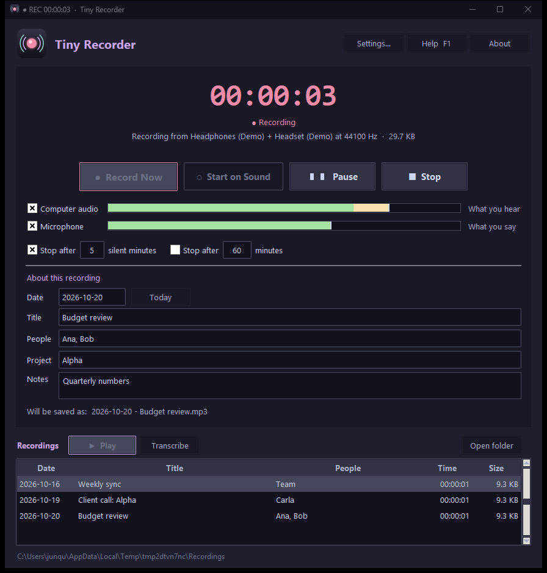
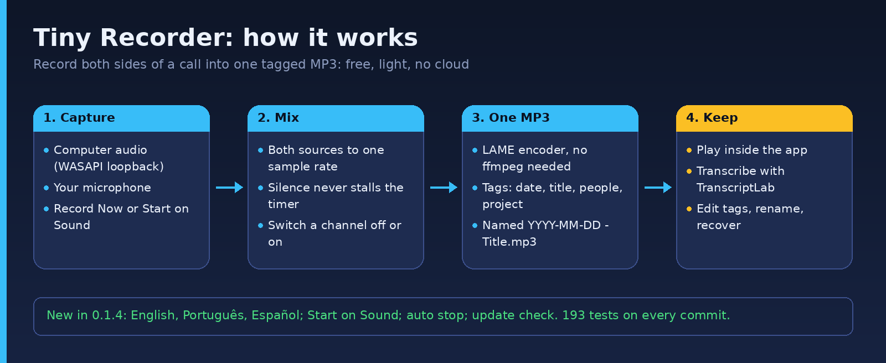

# Tiny Recorder

**A very light meeting recorder for Windows: everything the computer plays and everything you say, in one MP3 file.**

No AI, no cloud. Teams, Zoom, Meet, a browser, anything that makes sound. In English, Português (Brasil) and Español. To transcribe a recording, Tiny Recorder hands it to [TranscriptLab](https://github.com/junqueirach/transcriptlab), a separate free app that transcribes on your PC.

[](LICENSE)  [](https://github.com/junqueirach/tiny-recorder/actions/workflows/ci.yml) [](https://github.com/junqueirach/tiny-recorder/releases/latest)

<p align="center"></p>

**Download for Windows:** get `TinyRecorder_v<version>.exe` (about 24 MB) from the [latest release](https://github.com/junqueirach/tiny-recorder/releases/latest) and double-click it. No Python and no ffmpeg needed. The same exe is also in `TinyRecorder-<version>-win64.zip` together with the README, changelog and licence files. The SHA-256 checksums are in the release notes.

> **Windows SmartScreen:** the file is not code-signed, so Windows may show "Windows protected your PC". Click **More info**, then **Run anyway**. You can also run the app from source (see Quick start) and read every line of the code first.

## Why this exists

I always needed a recorder like this for my own use, and I never found a free, light and fast one. So I built my own, with Claude, in small steps.

It also completes my **corpus pipeline** (see my [profile](https://github.com/junqueirach)), the tools I am building to turn audio, documents and subtitles into clean Markdown that a RAG can search. That pipeline needs a simple way to capture the audio of meetings and calls. Tiny Recorder produces one tagged MP3 per meeting (date, title, people, project, notes), a plain file the transcription step can start from.

## How it works

<p align="center"></p>

1. Open Tiny Recorder before the meeting. **Computer audio** (what you hear) and **Microphone** (what you say) are ticked.
2. Press **● Record Now** (or **Ctrl+Alt+R** from any program). Join your call as usual. Still in a waiting room? Press **◌ Start on Sound**: the recording starts by itself when the call does.
3. Fill in **Title**, **People**, **Project** and **Notes** while you record, or later.
4. Press **■ Stop**. The MP3 is tagged and renamed to **`YYYY-MM-DD - Title.mp3`**.

## What it does

- **One mixed file**: loopback of the output device plus the microphone, brought to one sample rate and added together
- **Tags in the MP3** (ID3v2.4): date, title, people (artist), project (album), notes (comment); the file name follows them
- **Switch Computer audio or Microphone off and on while recording**: an unticked channel is not in the MP3
- **Play and Stop** inside the app: select a recording, press ▶ Play (or double-click); ■ Stop ends it
- **Edit later**: right-click a recording → *Edit details and rename…* rewrites the tags and renames the file; *Delete…* moves it to the Recycle Bin
- **Every file carries the Copyright tag** "not for distribution, personal use only"
- **Pause / Resume** (also **Ctrl+Alt+P** from any program), level meters for both sources, the window title shows `● REC 00:12:34` in the taskbar
- **Start on Sound**: waits with the devices open and starts writing when a ticked source has sound (the second before it included)
- **Auto stop**: after N silent minutes (on by default, 5) and / or at a set length, with the time it will stop
- **Transcribe with TranscriptLab**: a button and a right-click entry hand the selected recording to TranscriptLab 0.16.9 or newer; Tiny Recorder sends nothing anywhere
- **Warnings while recording**: Windows moved the sound to another device; the computer audio has been silent for 3 minutes
- **Check for updates** in About and Settings (GitHub releases; the exe can download and install the new version after checking its SHA-256; never checks by itself)
- **Light**: about 3 % of one CPU core while recording (measured 3.4 % with synthetic input, voice preset); voice quality (mono, 64 kbps) is about 29 MB per hour
- **Nothing is lost**: the MP3 is written while recording; an unfinished file is offered for recovery at the next start;
  the recording stops and saves by itself when the disk is almost full
- **A blocked microphone never loses the computer audio**: the other source is recorded and a warning is shown
- **About, Help (F1)**, English, Portuguese (Brazil) and Spanish (the Windows language by default, Settings → Interface language), Catppuccin Mocha dark theme; fits a 1366 × 768 screen

## Quick start

```
python -m venv venv
venv\Scripts\pip install -r requirements.txt
venv\Scripts\python tinyrecorder.py        (or double-click "Tiny Recorder.bat")
```

Needs Windows 10 or 11 and Python 3.10 or newer (tested on 3.10 and 3.12). No ffmpeg: the MP3 encoder (LAME) comes with the `lameenc` package.

Settings are kept in `%APPDATA%\TinyRecorder`. Recordings go to `Documents\Tiny Recorder` unless you choose another
folder in Settings.

## Responsible use

**Tell the people in a meeting that you are recording.** In many countries, recording a conversation
without the consent of the other participants can be a criminal offence.
Teams and Zoom announce their own recordings; Tiny Recorder does not announce anything to the others. This is not legal
advice. The repository contains no recordings.

## Development

```
venv\Scripts\pip install pytest pyflakes pillow
venv\Scripts\python -m pytest tests -q
venv\Scripts\python tools\gui_harness.py docs\screenshots     (screenshots of the app's own windows)
venv\Scripts\python tools\make_icon.py                         (rebuilds assets\icon.ico)
```

The audio engine takes any object with the `Source` interface, so the tests run it with fake sources and no sound card.
Tests use `TINYRECORDER_HOME` (a temp folder) and never touch the real settings. CI runs them on Linux (Python 3.10 and 3.12); the few tests that need Windows are skipped there.

| File | What it holds |
|---|---|
| `tinyrecorder.py` | the window, dialogs, the event queue |
| `tinyrecorder_audio.py` | devices, capture, mixer, MP3 stream |
| `tinyrecorder_player.py` | the built-in player (Windows MCI): Play and Stop |
| `tinyrecorder_core.py` | settings, file names, tags, recordings list, recovery, finding TranscriptLab, updates |
| `tinyrecorder_winsys.py` | single instance, dark title bar, hotkeys, Explorer, Windows language, default output device, starting TranscriptLab |
| `tinyrecorder_i18n.py`, `tinyrecorder_help.py` | the interface texts in English, Portuguese (Brazil) and Spanish; the Help window text |

## Project facts

- About 4,300 lines of app code in 7 files, 193 tests, 5 versions (the current one and 4 earlier ones in [`archive/versions`](archive/versions))
- Built with Python and Tkinter, packaged with PyInstaller
- Not tested from my side: pressing the global hotkey, real clicks and keys in the window, a real Teams or Zoom call

## How this was built

Tiny Recorder was written with Claude (Anthropic) as the coding assistant, in short versioned steps with tests for every change. I define what the tool must do and decide what ships. The [changelog](CHANGELOG.md) lists what changed in each version.

## Contributing and security

See [CONTRIBUTING.md](CONTRIBUTING.md) and [SECURITY.md](SECURITY.md). Bugs and ideas: [issues](https://github.com/junqueirach/tiny-recorder/issues).

## Licence

The source code of Tiny Recorder is **MIT** (see `LICENSE`).

> **The Windows exe contains GPL and LGPL components.** It bundles `mutagen` (GPL-2.0-or-later, the ID3 tags) and
> `lameenc` with the LAME encoder (LGPL-3.0-or-later, the MP3 encoder), so the exe as a whole is distributed under the terms
> of the GNU GPL version 3 or later. The complete source of this app is in this repository, the exact versions are in
> `requirements.txt`, and every component, licence and source address is listed in
> [`THIRD_PARTY_LICENSES.md`](THIRD_PARTY_LICENSES.md) (also in the release zip). Running from source with your own Python
> installs those packages yourself, and then only the MIT licence applies to the files of this repository.

## Author

Luiz Junqueira & Claude AI · junqueira.ch@gmail.com · [junqueira.ch](https://www.junqueira.ch)
